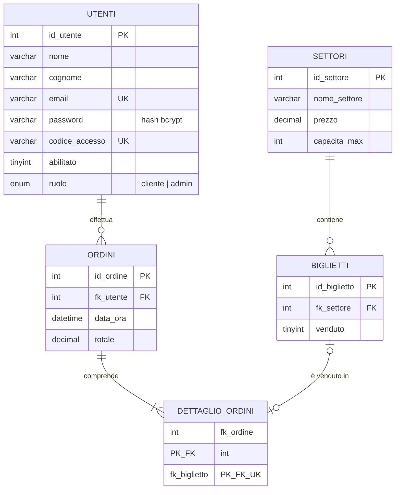
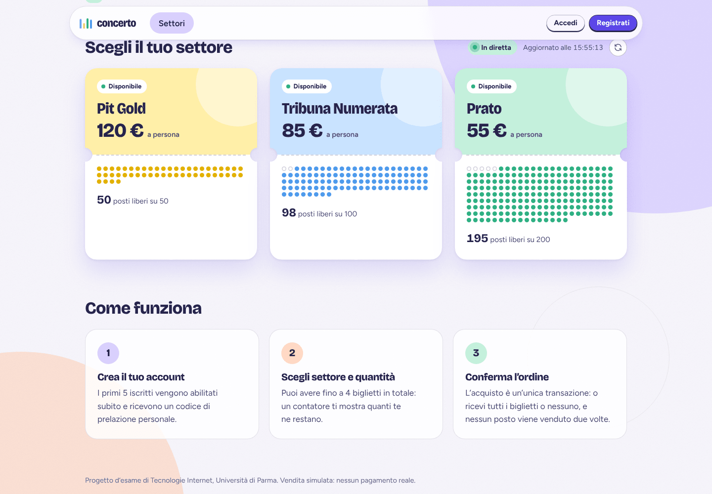
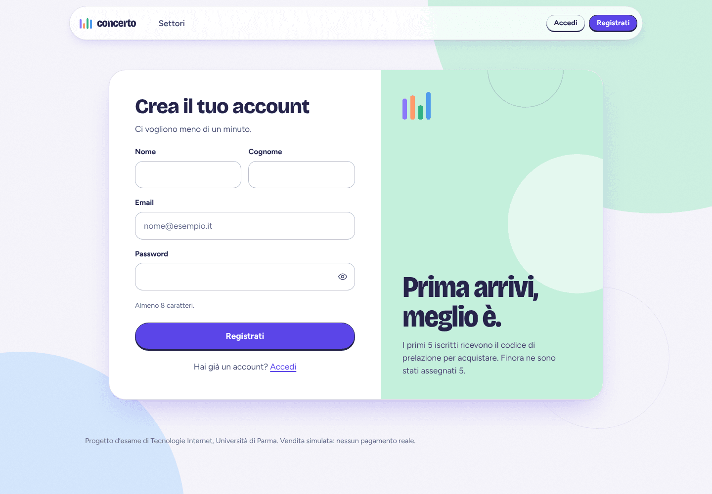
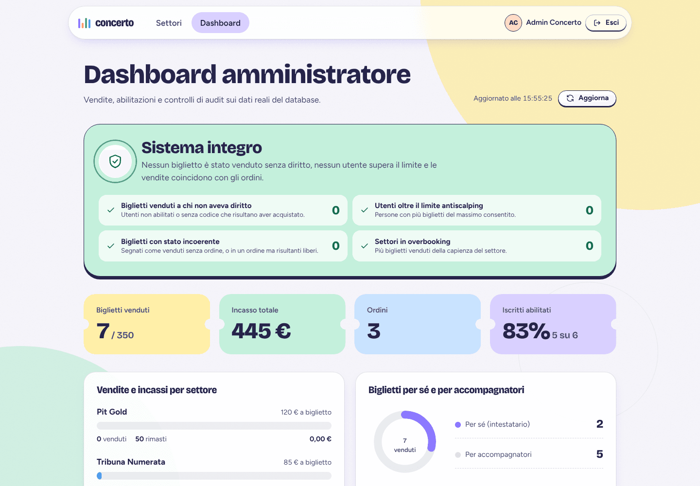
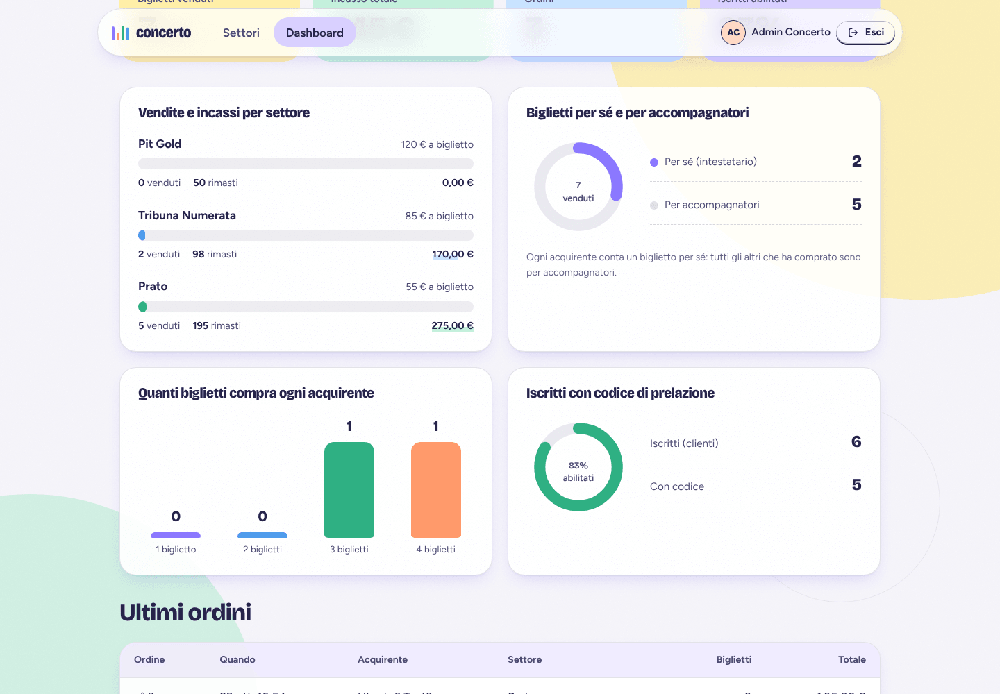
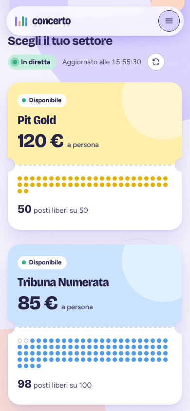

# Relazione tecnica – Piattaforma di vendita biglietti per un concerto

**Corso:** Tecnologie Internet – Università di Parma
**Candidata:** Marina Granatiero (matricola 367801), Corso di Laurea LIIET
**Repository:** progetto `client/` (React + Vite) e `server/` (Node.js + Express + MySQL)

---

## 1. Obiettivo e requisiti

Il progetto realizza una piattaforma web per la vendita simulata di biglietti di un concerto ad alta richiesta. Il problema da risolvere non è il semplice "carrello", ma la **vendita equa sotto carico**: pochi posti, molte persone, rischio di bagarinaggio (scalping) e di acquisti simultanei che vendono lo stesso posto due volte.

| Id | Requisito di business | Dove è garantito |
|---|---|---|
| R1 | I **primi 5 iscritti** (clienti) sono *abilitati* all'acquisto e ricevono un **codice di prelazione** univoco | `authController.register` + lock di registrazione |
| R2 | Ogni utente può acquistare **al massimo 4 biglietti** in totale (limite antiscalping) | transazione d'ordine + trigger nel database |
| R3 | Un biglietto non può mai essere venduto due volte (**niente overbooking**) | `SELECT … FOR UPDATE` + `UNIQUE(fk_biglietto)` |
| R4 | Un ordine è **atomico**: o tutti i biglietti richiesti o nessuno | transazione ACID con rollback |
| R5 | Disponibilità dei settori **in tempo reale** sul client | `GET /api/settori` + polling del client |
| R6 | Solo gli utenti abilitati accedono alla vendita; solo l'amministratore vede le statistiche | `ProtectedRoute` (client) + `authMiddleware`/`adminMiddleware` (server) |
| R7 | L'amministratore consulta statistiche aggregate (biglietti *per sé* vs *accompagnatori*) e una **sentinella di audit** che deve valere 0 | `adminController.statistiche`, `Admin.jsx` |

**Assunzione sul requisito "per sé / accompagnatori".** La specifica non dice come distinguere i due casi. Si è scelto: *ogni acquirente conta un biglietto per sé; tutti gli altri biglietti che ha acquistato sono per accompagnatori.* Quindi `per_sé = numero di acquirenti distinti`, `per_altri = biglietti venduti − per_sé`. La regola è isolata in una sola query e documentata anche nell'interfaccia.

---

## 2. Progettazione del database

### 2.1 Schema Entità-Relazione



### 2.2 Terza Forma Normale

- **1NF** – ogni attributo è atomico (il biglietto è una riga, non una lista dentro l'ordine).
- **2NF** – la chiave composta `(fk_ordine, fk_biglietto)` di `dettaglio_ordini` non ha attributi non-chiave: nessuna dipendenza parziale. Nelle altre tabelle la chiave è un singolo identificatore.
- **3NF** – nessuna dipendenza transitiva: il prezzo dipende solo dal settore (non è ripetuto nei biglietti né negli ordini); il nome del settore non è copiato altrove; il totale dell'ordine è il solo dato derivato, mantenuto per conservare il prezzo *storico* anche se il listino cambia.

### 2.3 Vincoli e difese a livello di database

| Meccanismo | Scopo |
|---|---|
| `UNIQUE(email)`, `UNIQUE(codice_accesso)` | niente doppie registrazioni né codici duplicati |
| `UNIQUE(fk_biglietto)` in `dettaglio_ordini` | un biglietto non può stare in due ordini, **qualunque cosa faccia l'applicazione** |
| Chiavi esterne con `ON DELETE CASCADE` solo su settore→biglietti | integrità referenziale |
| Indice `(fk_settore, venduto)` | rende veloci il conteggio delle disponibilità e il blocco dei biglietti liberi |
| Trigger `trg_limite_biglietti` (`BEFORE INSERT` su `dettaglio_ordini`, `SIGNAL 45000`) | **ultima linea di difesa** del limite di 4: vale anche per un `INSERT` manuale da phpMyAdmin |
| Motore InnoDB | transazioni e lock a livello di riga |

Lo script `schema.sql` è **idempotente** (rieseguibile senza perdere dati) e include i dati di prova: 3 settori (Pit Gold 50 posti a 120 €, Tribuna Numerata 100 a 85 €, Prato 200 a 55 €), 350 biglietti generati con una CTE ricorsiva e l'utente amministratore. `npm run db:init` / `db:reset` lo eseguono con un parser che rispetta `DELIMITER` (serve per il trigger).

---

## 3. Architettura

```
 Browser (React SPA, Vite)                 Server (Node.js + Express 5)                  MySQL / MariaDB
┌───────────────────────────┐   HTTPS    ┌────────────────────────────────────┐        ┌─────────────────┐
│ Pages: Home Login Register│  JSON/JWT  │ routes → middleware → controllers  │  pool  │ utenti  ordini  │
│        Acquista  Admin    │ ─────────▶ │  authMiddleware (JWT, 401)         │ ─────▶ │ biglietti       │
│ AuthContext · ProtectedRt │            │  adminMiddleware (ruolo da DB, 403)│  ACID  │ dettaglio_ordini│
│ Axios + interceptor 401   │ ◀───────── │  errorHandler (JSON uniforme)      │ ◀───── │ settori + trigger│
└───────────────────────────┘            └────────────────────────────────────┘        └─────────────────┘
```

**Server.** `app.js` costruisce l'applicazione (separata da `index.js`, così i test la avviano su una porta casuale); un solo pool `mysql2/promise` (`db.js`); configurazione centralizzata in `config/index.js` (il server **non parte** senza `JWT_SECRET`); `utils/validators.js` per la validazione stretta degli input; `errorHandler` converte ogni errore (anche JSON malformato o body troppo grande) in una risposta JSON coerente. Express 5 inoltra automaticamente le eccezioni dei controller asincroni.

**Client.** SPA React con `react-router-dom`; stato di sessione in `AuthProvider`; `services/api.js` (Axios) inietta il token e, su una risposta 401, chiude la sessione e porta al login; hook dedicati (`useSettori` per il tempo reale, `useRegole` per leggere le regole dal server invece di duplicarle nel client).

**API.** La tabella completa dei percorsi e dei codici di stato è nel `README.md`. Convenzione: **401** = non autenticato/token non valido o scaduto, **403** = autenticato ma senza diritto, **404** = risorsa inesistente, **409** = conflitto con una regola di business (limite superato, posti esauriti, email già usata), **400** = dati non validi.

---

## 4. Sicurezza

| Rischio | Contromisura |
|---|---|
| Password rubate dal DB | solo **hash bcrypt** (costo 10); nessuna password nelle risposte; hash fittizio per confronti a tempo costante quando l'email non esiste; le vecchie password in chiaro delle prime giornate vengono convertite in hash al primo login riuscito (confronto a tempo costante) |
| Token falsificati | JWT firmato con segreto da `.env` (nessuna chiave di ripiego nel codice); token scaduto, manomesso o firmato con altra chiave → **401** |
| Privilege escalation | `abilitato` e `ruolo` **non si leggono dal token**: `adminMiddleware` e la transazione d'acquisto li rileggono dal database a ogni richiesta, quindi un admin retrocesso o un utente cancellato perdono subito i diritti anche con un token ancora valido |
| Registrazione con privilegi | il ruolo non è mai accettato dal body: tutte le registrazioni sono `cliente` |
| SQL injection | query **sempre parametrizzate** (`?`); validazione che accetta solo interi positivi (impedisce anche l'iniezione tramite oggetti di `mysql2`) |
| Accesso diretto agli URL | lato client `ProtectedRoute` (con `richiede="abilitato"` / `"admin"`), lato server middleware su ogni rotta protetta: il blocco client è solo cortesia di interfaccia, la sicurezza è nel server |
| Abusi sul corpo delle richieste | `express.json({ limit: '10kb' })` → 413; JSON malformato → 400 in JSON |
| Informazioni nelle intestazioni | `x-powered-by` rimosso, `X-Content-Type-Options`, `X-Frame-Options`, `Referrer-Policy` |
| XSS | React esegue l'escape di ogni testo; nessun `dangerouslySetInnerHTML` |
| CORS | origine configurabile con `CLIENT_ORIGIN` |

Limiti noti: nessun *rate limiting* sul login (da aggiungere in produzione), token in `localStorage` (accettabile per un progetto didattico; in produzione meglio cookie `HttpOnly`), HTTPS demandato al reverse proxy.

---

## 5. Concorrenza e transazioni ACID (cuore del progetto)

### 5.1 Il problema trovato nel codice iniziale

La versione iniziale di `POST /api/ordini` apriva una transazione ma **leggeva lo storico dell'utente senza alcun lock**, poi bloccava i biglietti. Due richieste simultanee dello stesso utente leggono entrambe "0 biglietti acquistati", passano entrambe il controllo e inseriscono entrambe l'ordine: *time-of-check / time-of-use*. Per verificarlo non ci si è fidati del ragionamento: è stato scritto un test che lancia **12 ordini da 1 biglietto contemporaneamente** con lo stesso utente. Con il codice originale **tutti e 12 hanno avuto successo** (12 biglietti invece di 4). La correzione è stata poi validata con lo stesso test, che ora fallisce se la correzione viene rimossa (*mutation test*).

### 5.2 La soluzione

`eseguiOrdine` esegue sempre **gli stessi lock nello stesso ordine**:

1. **Riga dell'utente** `SELECT … FOR UPDATE` → serializza tutti gli ordini *dello stesso utente* (due schede o uno script non possono aggirare il limite). Solo dopo si legge lo storico: in `REPEATABLE READ` lo *snapshot* nasce alla prima lettura non bloccante, quindi leggere dopo il lock garantisce di vedere gli ordini appena confermati da altre transazioni.
2. **Riga del settore** `FOR UPDATE` → serializza gli ordini sullo stesso settore e legge il prezzo.
3. **Righe dei biglietti** `SELECT id_biglietto … WHERE venduto = 0 ORDER BY id_biglietto LIMIT n FOR UPDATE` → ogni biglietto è assegnato a una sola transazione.
4. `INSERT` dell'ordine, `INSERT` multiplo del dettaglio, `UPDATE biglietti … AND venduto = 0` con controllo di `affectedRows`, quindi `COMMIT`. Qualsiasi errore → `ROLLBACK`: **atomicità**.

Ulteriori accorgimenti:
- **Ordine dei lock costante** per prevenire i deadlock; se MySQL ne rileva comunque uno (errno 1213) l'ordine viene **ritentato** automaticamente (fino a 4 volte con attesa casuale crescente).
- **Importi in centesimi interi** (nessun errore di arrotondamento sui decimali).
- **Registrazione dei "primi 5"** protetta con `GET_LOCK('concerto:registrazione')`: il conteggio degli iscritti e l'inserimento diventano una sezione critica unica (l'hash bcrypt, lento, si calcola *prima* di prendere il lock). Il conteggio considera solo gli utenti `cliente`: nel codice originale l'amministratore occupava uno dei 5 posti.
- **Difesa in profondità**: anche se tutta la logica applicativa fosse bypassata, `UNIQUE(fk_biglietto)` e il trigger del database impediscono overbooking e superamento del limite.

### 5.3 Prove di carico (test automatici su database reale)

| Scenario | Esito atteso e ottenuto |
|---|---|
| 12 ordini da 1 biglietto dello stesso utente, lanciati insieme su settori diversi | passano esattamente **4** |
| 6 ordini da 2 biglietti insieme (stesso utente) | passano esattamente **2** (4 biglietti) |
| 5 ordini da 4 biglietti insieme (stesso utente) | ne passa **uno** |
| 20 utenti si contendono gli ultimi 10 biglietti | venduti esattamente **10** |
| 8 utenti chiedono 2 biglietti con 5 rimasti | passano 2 ordini, mai oltre la capienza |
| 12 registrazioni simultanee | abilitati esattamente **5**, codici tutti diversi |
| Stress misto: 60 utenti, ordini casuali ripetuti e simultanei | gli **invarianti** restano veri: nessun biglietto in due ordini, nessun utente oltre 4, venduti = righe di dettaglio, nessun settore oltre la capienza |

---

## 6. Client React

**Routing e protezione.** `/` (pubblica), `/login`, `/register`, `/acquista` (`ProtectedRoute richiede="abilitato"`), `/admin` (`richiede="admin"`), `*` → 404. Alla navigazione diretta verso una pagina protetta: utente anonimo → login con messaggio e ritorno alla pagina richiesta dopo l'accesso; utente senza diritto → home con avviso. All'avvio la sessione salvata viene **riconfermata** con `GET /auth/me`: i dati in `localStorage` non sono mai considerati affidabili (un `ruolo: "admin"` scritto a mano non apre nulla, perché il server risponde 401/403).

**Acquisto (`Acquista.jsx`).** Scelta del settore (con disponibilità in tempo reale, aggiornata ogni 6–8 s e al ritorno sulla scheda), selettore della quantità limitato a `min(rimanenti, disponibili)`, riepilogo con totale dinamico, contatore dei biglietti già acquistati (`x su 4`). Al termine, in ogni caso (successo o errore), disponibilità e limite vengono riallineati al database. Gli errori della transazione (409 limite/esaurito, 403) sono mostrati con il messaggio del server.

**Dashboard (`Admin.jsx`).** Sentinella di audit (4 controlli: acquisti non autorizzati, utenti oltre il limite, biglietti incoerenti, overbooking; verde se tutto è 0, rossa con conteggio delle anomalie altrimenti), indicatori principali, vendite e incassi per settore, anello *per sé / accompagnatori*, istogramma "quanti biglietti compra ogni acquirente", ultimi ordini, elenco clienti con codici.

**Qualità del codice.** ESLint con le regole `react-hooks` v7 senza errori né avvisi (nessun `setState` sincrono negli effetti, rendering puro, contesto separato dai componenti per il *fast refresh*).

---

## 7. Interfaccia e design system (Giornata 8)

**Direzione.** Tonalità *pastello e chiare*, fresca e non banale, con transizioni dinamiche. Il tema è la **carta ritagliata e il biglietto**: ogni elemento di vendita è un biglietto con *strappo* (le tacche semicircolari si ottengono con maschere CSS, non con immagini) e linea perforata. È l'unico "motivo forte"; il resto è sobrio.

| Elemento | Scelta |
|---|---|
| Palette | carta `#F8F7FC`, inchiostro indaco `#26244A`; pastelli lilla, pesca, menta, cielo, burro, rosa; versioni cariche per puntini, barre e stati; accento d'azione `#5B45E8` |
| Tipografia | *Bricolage Grotesque* (titoli, asse di larghezza condensato) + *Figtree* (testo) + *DM Mono* (codici); font variabili self-hosted in `woff2` (≈ 84 KB + 20 KB + 9 KB, ridotti ai soli caratteri latini), nessuna richiesta a CDN |
| Forme | pillole per i bottoni, raggi grandi per i pannelli, ombre tinte di viola invece del grigio neutro |

**Movimento** (sempre motivato da un'azione o da un cambio di stato):
- **Sipario di pagina**: un pannello pastello sale, copre la pagina, a sipario chiuso si cambia pagina e il pannello continua a salire; il colore segue la sezione e `body[data-tono]` anima lo sfondo con `@property`.
- **Posti come puntini**: ogni posto del settore è un puntino; quando un altro utente compra, i puntini corrispondenti "scoppiano" e si svuotano in tempo reale.
- Numeri che scorrono (`AnimatedNumber`), pillola di navigazione che scivola sotto la voce attiva, biglietto della home che segue il puntatore, timbro "Confermato"/"Esaurito", coriandoli alla conferma, anelli e istogrammi che si disegnano.
- **`prefers-reduced-motion`** rispettato: niente sipario né conteggi animati, i valori compaiono subito.

**Accessibilità e responsive.** Link "salta al contenuto", focus visibile su ogni controllo, focus spostato sul contenuto dopo ogni cambio pagina, `aria-live` per quantità e limiti, errori dei campi associati con `aria-describedby`, contrasti **≥ 4,5:1** per i testi (verificati con il calcolo WCAG sulle coppie colore principali), layout a 16 px di margine su smartphone senza scroll orizzontale, menu a comparsa su schermi stretti.

---

## 8. Collaudo (Giornata 9)

### 8.1 Test automatici del server – 74 test, tutti superati
Eseguiti con `npm test` su un database dedicato `concerto_test` (azzerato a ogni esecuzione) e vera concorrenza (`Promise.all` su richieste HTTP reali).

| File | Test | Contenuto |
|---|---|---|
| `auth.test.js` | 18 | validazione, regola dei primi 5 (anche con 12 registrazioni simultanee), email duplicate, bcrypt, login, SQL injection, JWT scaduto/manomesso, `/auth/me` |
| `orders.test.js` | 23 | **bypass** (senza token, token non valido, non abilitato, admin, utente cancellato), validazione payload, acquisto, **limite 4 cumulativo**, esaurimento, **rollback**, `UNIQUE`, **trigger**, FK |
| `concurrency.test.js` | 7 | gli scenari di carico della tabella del §5.3 |
| `admin.test.js` | 11 | protezione `/api/admin` (ruolo riletto dal DB, admin retrocesso), correttezza delle statistiche, **sentinella** che rileva incoerenze introdotte a mano |
| `security.test.js` | 8 | rotte protette senza credenziali, header malformati, payload ostili senza 500, limite 10 KB, header di sicurezza, CORS |
| `unit.test.js` | 4 | validatori e parser SQL |

### 8.2 Collaudo nel browser – 21 verifiche (`npm run test:e2e`)
Chromium reale contro server e database veri:
1. registrazione con errori di validazione, poi primo iscritto con **codice di prelazione** e accesso automatico;
2. acquisto Tribuna ×2 e Prato ×2: contatore *x su 4*, pulsante bloccato al limite, **5° biglietto rifiutato dal server (409) anche aggirando l'interfaccia**;
3. **URL digitati a mano**: `/admin` da cliente → home con avviso; utente senza prelazione → `/acquista` negato e ordine respinto dal server (403); anonimo → login; **token manomesso con utente "admin" finto** → sessione chiusa;
4. credenziali errate; dashboard admin con sentinella verde e statistiche coerenti (4/350 venduti, 280 €, 1 per sé + 3 accompagnatori);
5. sipario di transizione, tono dello sfondo, focus, doppio click veloce, pulsante *Indietro*, tastiera;
6. **tempo reale**: un acquisto di un altro utente cambia i posti sullo schermo senza ricaricare;
7. `prefers-reduced-motion`; smartphone (menu, nessuno scroll orizzontale); console del browser **senza errori né avvisi**.

Sono state verificate a mano (con modifiche dirette al database) anche le viste di errore: sentinella **rossa** con 50 anomalie quando un settore viene segnato venduto senza ordini, e settore **esaurito** con timbro.

### 8.3 Difetti trovati e corretti rispetto alla versione di partenza

| # | Difetto | Correzione |
|---|---|---|
| 1 | `Cannot find module './routes/authRoutes'` e due implementazioni parallele dell'autenticazione (`routes/auth.js`, `routes/authRoutes.js`) con due pool DB (`config/db.js`, `db.js`) e due segreti JWT di ripiego diversi | un solo controller (`authController`), un solo pool, nessun segreto nel codice |
| 2 | **Race condition** sul limite dei 4 biglietti (12 ordini paralleli → 12 biglietti) | lock sulla riga utente + ordine dei lock costante + retry sui deadlock |
| 3 | Registrazione dei primi 5 non atomica; il conteggio includeva l'amministratore; codice generato con `Math.random()` | `GET_LOCK`, conteggio dei soli clienti, codici da `crypto.randomBytes` con gestione delle collisioni |
| 4 | Una variante dell'autenticazione (`routes/auth.js`) confrontava la password *in chiaro* come "compatibilità" (scorciatoia di sicurezza permanente), mentre quella in uso non faceva accedere gli account creati con password in chiaro nelle prime prove | un solo percorso sicuro con **migrazione automatica a bcrypt** al primo login riuscito |
| 5 | Token scaduto/non valido → **403**, indistinguibile da "non autorizzato" (il client non poteva chiudere la sessione) | 401 + gestione globale nell'interceptor del client |
| 6 | Quantità non validata (stringhe, decimali), settore inesistente indistinguibile da settore esaurito, `UPDATE` senza controllo di `venduto = 0`, una coppia di query per ogni biglietto | validazione stretta, 404 dedicato, inserimento multiplo, verifica di `affectedRows` |
| 7 | Conflitti di business restituiti come 400 | 409 con messaggi chiari |
| 8 | JSON malformato → pagina HTML d'errore; nessuna rotta 404 in JSON | `errorHandler` e `notFound` uniformi |
| 9 | Ruolo e abilitazione fidati dal token / da `localStorage` | riletti dal database; sessione riconfermata all'avvio |
| 10 | Template Vite non ripulito (CSS, immagini e `App.css` inutilizzati, doppio `AuthContext`) | rimossi |

Durante il collaudo nel browser è emerso anche un difetto **introdotto dal nuovo client** e non visibile in produzione a prima vista: eseguendo il client in modalità sviluppo (React *StrictMode*, che esegue due volte gli effetti), l'accesso diretto a una pagina protetta generava un **ciclo di reindirizzamenti** (50–60 navigazioni e l'errore *Maximum update depth exceeded*). Causa: `<Navigate>` naviga in un effetto che dipende dall'oggetto `state`, e `ProtectedRoute` ne creava uno nuovo a ogni rendering mentre la vecchia pagina restava montata sotto il sipario. Correzione: oggetti `state` stabili (`useMemo` / costanti di modulo). Il collaudo ora **conta le navigazioni** di ogni reindirizzamento (al massimo 4) ed è eseguito sia su una build di produzione sia su una di sviluppo; rimettendo il codice errato il test fallisce (52 e 60 navigazioni), quindi la regressione è coperta.

### 8.4 Ambiente di collaudo e limiti
- Il collaudo è stato eseguito su **MariaDB 10.11 (InnoDB)** compilata nell'ambiente di lavoro, non sull'XAMPP della candidata: il comportamento dei lock `FOR UPDATE` e degli isolation level è lo stesso di MySQL, ma conviene rieseguire `npm test` e `npm run test:e2e` sul proprio XAMPP come ultima verifica.
- L'ambiente di lavoro non consentiva di eseguire `vite build`; il client è stato compilato e provato con **esbuild** (stesso codice sorgente e CSS). `npm run build` e `npm run dev` vanno lanciati almeno una volta in locale.
- Non sono implementati (fuori specifica): pagamento reale, e-mail di conferma, *rate limiting*, annullamento ordini.

---

## 9. Istruzioni di consegna

1. `cd server && npm install && npm run db:init && npm start`
2. `cd client && npm install && npm run dev` → <http://localhost:5173>
3. Verifica: `cd server && npm test`; `cd client && npm run lint`.
4. Sincronizzazione Git: `git add -A`, `git commit -m "Giornate 6-9: transazioni sicure, dashboard admin, restyling, collaudo e relazione"`, `git push`.

### Appendice – Schermate

| | |
|---|---|
|  |  |
|  |  |
|  |  |
|  |  |
